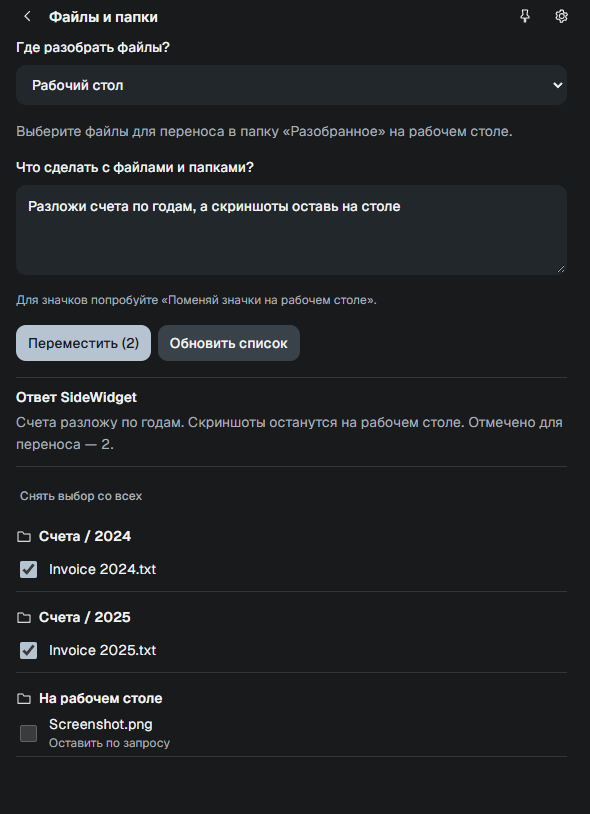

# SideWidget

**Русский** · [English](docs/github/README.en.md) · [简体中文](docs/github/README.zh-CN.md) · [日本語](docs/github/README.ja.md) · [Deutsch](docs/github/README.de.md) · [Українська](docs/github/README.uk.md) · [Беларуская](docs/github/README.be.md) · [Español](docs/github/README.es.md) · [Português (Brasil)](docs/github/README.pt-BR.md)

SideWidget — компактная панель повседневных инструментов для Windows. У верхнего края экрана видны часы. По нажатию открываются поиск, закреплённые программы и другие инструменты. По умолчанию панель можно вызвать с помощью `Ctrl+Alt+Space`.

SideWidget выбирает язык Windows. Если его нет в списке, приложение открывается на английском. Язык можно сменить в **Настройках → Язык приложения**.

Проект разрабатывается со здравым смыслом и с помощью GPT-6.1 Sol.

## Снимки экрана

  

  

Плеер снят на Windows во время воспроизведения музыки. Снимки инструментов используют демонстрационные данные.

## Примеры команд

Откройте **Файлы и папки**, вставьте команду и проверьте план перед применением.

| Язык и снимок | Сортировка | Значки папок |
| --- | --- | --- |
| [Русский](docs/github/images/sidewidget-commands-ru.png) | `Разложи счета по годам, а скриншоты оставь на столе` | `Поменяй значки на рабочем столе` `Поменяй значок папки на фото` |
| [English](docs/github/images/sidewidget-commands-en.png) | `Sort invoices by year and leave screenshots on the desktop` | `Change desktop folder icons` `Change the folder icon to photos` |
| [简体中文](docs/github/images/sidewidget-commands-zh-CN.png) | `把发票按年份整理，截图留在桌面` | `更改桌面文件夹图标` `将文件夹图标改为照片` |
| [日本語](docs/github/images/sidewidget-commands-ja.png) | `請求書を年別に整理して、スクリーンショットはデスクトップに残して` | `デスクトップのフォルダーアイコンを変更して` `フォルダーアイコンを写真に変更して` |
| [Deutsch](docs/github/images/sidewidget-commands-de.png) | `Sortiere Rechnungen nach Jahren und lass Screenshots auf dem Desktop` | `Ändere die Ordnersymbole auf dem Desktop` `Ändere das Ordnersymbol zu Fotos` |
| [Українська](docs/github/images/sidewidget-commands-uk.png) | `Розклади рахунки за роками, а знімки екрана залиш на робочому столі` | `Зміни значки папок на робочому столі` `Зміни значок папки на фото` |
| [Беларуская](docs/github/images/sidewidget-commands-be.png) | `Раскладзі рахункі па гадах, а здымкі экрана пакінь на працоўным стале` | `Змяні значкі папак на працоўным стале` `Змяні значок папкі на фота` |
| [Español](docs/github/images/sidewidget-commands-es.png) | `Ordena las facturas por año y deja las capturas de pantalla en el escritorio` | `Cambia los iconos de las carpetas del escritorio` `Cambia el icono de la carpeta a fotos` |
| [Português (Brasil)](docs/github/images/sidewidget-commands-pt-BR.png) | `Organize as faturas por ano e deixe as capturas de tela na área de trabalho` | `Altere os ícones das pastas da área de trabalho` `Troque o ícone da pasta por fotos` |

## Другие инструменты

<strong>Калькулятор</strong>

Посчитайте выражение с процентами и скобками, скопируйте результат или вернитесь к вычислению из истории.

<strong>QR-коды</strong>

Превратите ссылку или текст в QR-код и сохраните его в SVG, PNG или JPEG.

<strong>Конвертер единиц</strong>

Переводите расстояния, температуру и другие величины. Частые пары можно закрепить в избранном.

<strong>Пипетка и цвета</strong>

Возьмите цвет с экрана, скопируйте его в HEX, RGB или HSL и сохраните в палитре.

## Возможности

- Калькулятор с историей, QR-коды в SVG, PNG и JPEG, конвертер единиц, пипетка и преобразование цветов.
- Поиск файлов через установленный и запущенный Everything, запуск закреплённых программ.
- **Файлы и папки.** Сортировка файлов рабочего стола, предпросмотр значков папок, единый стиль или свой для каждой папки и отмена последнего изменения значков.
- Управление совместимыми проигрывателями, микшер громкости и показатели компьютера.
- Календарь, локальный черновик Markdown и перевод через внешние сервисы.
- Настройка размера, сочетания клавиш и списка мониторов, на которых видна панель.

## Установка

Для Windows 10 или 11 x64. Откройте [Releases](https://github.com/Kelltomal/SideWidget/releases/latest) и выберите ZIP.

- **Lite** (`-lite-win-x64.zip`) — рекомендуемая версия. Архив приложения занимает около 20 МБ. Среды выполнения скачиваются отдельно по необходимости.
- **Полная** (`-portable-win-x64.zip`) включает библиотеки для автономного запуска.

Для полной версии достаточно распаковать ZIP и открыть `SideWidget.exe`.

### Первый запуск Lite

1. Скачайте ZIP с окончанием `-lite-win-x64.zip` и распакуйте его целиком. [Скачать Lite](https://github.com/Kelltomal/SideWidget/releases/latest)
2. Если SideWidget уже запущен, нажмите **Выйти** в меню значка в трее. Откройте `SideWidget.exe` рядом с папкой `App`.
3. При нехватке зависимостей лаунчер скачает нужные ZIP из релиза этой версии на GitHub и распакует их в соседнюю папку `Dependencies`. Для скачивания нужен интернет. Чтобы открыть панель после запуска, нажмите `Ctrl+Alt+Space`.

Если переходите с полной версии и пользуетесь автозапуском, включите **Запускать при входе в Windows** в настройках Lite. При следующем входе Windows запустит эту копию.

Если скачивание прервалось, снова запустите `SideWidget.exe`. Готовые пакеты в этой папке будут использованы повторно. Для Lite 0.3.2 действует прежний порядок с `Install-Dependencies.bat`.

### Ручная установка зависимостей Lite

Установите следующие пакеты x64 один раз. Прямые ссылки ведут к установщикам Microsoft.

- [.NET Runtime 10.0 x64](https://aka.ms/dotnet/10.0/dotnet-runtime-win-x64.exe)
- [ASP.NET Core Runtime 10.0 x64](https://aka.ms/dotnet/10.0/aspnetcore-runtime-win-x64.exe)
- [Windows App Runtime 1.8.12 x64](https://aka.ms/windowsappsdk/1.8/1.8.260921001/windowsappruntimeinstall-x64.exe)
- [Microsoft Edge WebView2 Evergreen](https://go.microsoft.com/fwlink/p/?LinkId=2124703)
- [Microsoft Visual C++ Redistributable v14 x64](https://aka.ms/vc14/vc_redist.x64.exe)

### Обновление Lite

SideWidget проверяет стабильные релизы при запуске. Для ручной проверки откройте раздел **Обновления** в настройках и нажмите **Проверить обновления**. Кнопка **Обновить сейчас** скачает Lite ZIP, установит новую версию и перезапустит виджет через лаунчер.

Для перехода с 0.3.1 выполните установку вручную. Выберите Lite и пройдите шаги первого запуска или распакуйте полную версию и откройте `SideWidget.exe`. Начиная с 0.3.2 полная версия автоматически выбирает Lite при обновлении, если нужные библиотеки уже установлены.

## Everything

Everything — отдельный индексатор voidtools. SideWidget использует его для поиска файлов и папок из главной панели. «Файлы и папки», калькулятор и остальные инструменты работают самостоятельно.

1. Скачайте **Download Installer 64-bit** для обычного стабильного Everything. SideWidget подключается через IPC, доступный в обычном выпуске. [Загрузки voidtools](https://www.voidtools.com/downloads/)

2. В установщике выберите **Install Everything service**, чтобы индексировать NTFS, пока основное окно работает с правами обычного пользователя. Запустите `Everything.exe` в текущем сеансе Windows и дождитесь индексации. Для поиска сразу после входа можно включить **Start Everything on system startup**. [Установка Everything](https://www.voidtools.com/support/everything/installing_everything/)

3. Откройте SideWidget через `Ctrl+Alt+Space` и введите часть имени. Например, `invoice *.pdf` ищет PDF с `invoice` в имени, а `\downloads *.zip` — ZIP в папках Downloads. SideWidget показывает до 50 совпадений. [Синтаксис Everything](https://www.voidtools.com/support/everything/searching/)

Если поиск недоступен, проверьте, что запущен обычный, стандартный экземпляр Everything в том же сеансе Windows и с тем же уровнем прав, что SideWidget. Если пропал отдельный диск, проверьте, включён ли он в индекс Everything.

## Документация проекта

[Сборка и вклад в проект](CONTRIBUTING.md) · [Техническая справка](docs/github/technical.ru.md) · [Сообщить об ошибке](https://github.com/Kelltomal/SideWidget/issues/new/choose) · [Сообщить об уязвимости](SECURITY.md) · [Переводы через Weblate](docs/github/translating.md)
