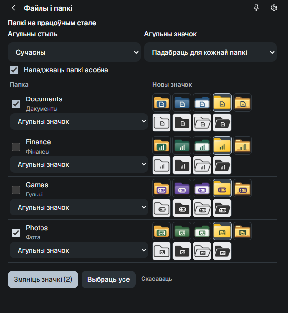

# SideWidget

[Русский](../../README.md) · [English](README.en.md) · [简体中文](README.zh-CN.md) · [日本語](README.ja.md) · [Deutsch](README.de.md) · [Українська](README.uk.md) · **Беларуская** · [Español](README.es.md) · [Português (Brasil)](README.pt-BR.md)

SideWidget — кампактная панэль для штодзённых задач у Windows. Уверсе экрана бачны гадзіннік. Націсніце на яго, каб адкрыць пошук файлаў, замацаваныя праграмы і іншыя інструменты. Стандартнае спалучэнне клавіш — `Ctrl+Alt+Space`.

SideWidget выбірае мову Windows. Калі такой мовы няма ў спісе, праграма адкрываецца па-англійску. Мову можна змяніць у меню **Налады → Мова праграмы**.

SideWidget распрацоўваецца са здаровым сэнсам і з дапамогай GPT-6.1 Sol.

## Здымкі экрана

  

  

Прайгравальнік зняты ў Windows падчас музыкі. На здымках інструментаў выкарыстаны дэманстрацыйныя даныя.

## Прыклады каманд

Адкрыйце **Файлы і папкі**, устаўце каманду і праверце план перад ужываннем.

- **Сартаванне.** `Раскладзі рахункі па гадах, а здымкі экрана пакінь на працоўным стале`
- **Значкі папак.** `Змяні значкі папак на працоўным стале` `Змяні значок папкі на фота`

[Усе дзевяць моў](../../README.md#примеры-команд)

## Іншыя інструменты

<strong>Калькулятар</strong>

Вылічыце выраз з працэнтамі і дужкамі, скапіруйце вынік або вярніцеся да разліку з гісторыі.

<strong>QR-коды</strong>

Ператварыце тэкст або спасылку ў QR-код і захавайце яго ў SVG, PNG ці JPEG.

<strong>Канвертар адзінак</strong>

Пераўтварайце адлегласці, тэмпературу і іншыя велічыні. Частыя пары можна захаваць у абраным.

<strong>Піпетка і колеры</strong>

Вазьміце колер з экрана, скапіруйце яго ў HEX, RGB ці HSL і захавайце ў палітры.

## Магчымасці

- Калькулятар з гісторыяй, QR-коды ў фарматах SVG, PNG і JPEG, пераўтварэнне адзінак вымярэння, піпетка і пераўтварэнне фарматаў колераў.
- Пошук файлаў праз запушчаны Everything і хуткі запуск замацаваных праграм.
- **Файлы і папкі.** Упарадкаванне файлаў на працоўным стале, папярэдні прагляд значкоў папак, агульны стыль або асобны для кожнай папкі і адмена апошняй змены значкоў.
- Кіраванне прайграваннем у сумяшчальных прайгравальніках, мікшар гучнасці і паказчыкі сістэмы.
- Каляндар, лакальны чарнавік Markdown і пераклад праз знешнія сэрвісы.
- Налады памеру панэлі і спалучэння клавіш, выбар манітораў для паказу панэлі.

## Усталяванне

Для Windows 10 або 11 x64. Адкрыйце [Releases](https://github.com/Kelltomal/SideWidget/releases/latest) і выберыце ZIP.

- **Lite** (`-lite-win-x64.zip`) — рэкамендаваны варыянт. Адсутныя бібліятэкі спампоўваюцца асобна.
- **Поўная версія** (`-portable-win-x64.zip`) уключае бібліятэкі для аўтаномнага запуску.

Распакуйце ZIP у асобную папку і адкрыйце `SideWidget.exe` побач з папкай `App`. У новых выпусках Lite патрэбныя пакеты спампоўваюцца з GitHub у папку `Dependencies`.

### Ручное ўсталяванне залежнасцей Lite

Усталюйце гэтыя пакеты x64 адзін раз. Спасылкі вядуць да праграм усталявання Microsoft.

- [.NET Runtime 10.0 x64](https://aka.ms/dotnet/10.0/dotnet-runtime-win-x64.exe)
- [ASP.NET Core Runtime 10.0 x64](https://aka.ms/dotnet/10.0/aspnetcore-runtime-win-x64.exe)
- [Windows App Runtime 1.8.12 x64](https://aka.ms/windowsappsdk/1.8/1.8.260921001/windowsappruntimeinstall-x64.exe)
- [Microsoft Edge WebView2 Evergreen](https://go.microsoft.com/fwlink/p/?LinkId=2124703)
- [Microsoft Visual C++ Redistributable v14 x64](https://aka.ms/vc14/vc_redist.x64.exe)

Пры запуску SideWidget правярае стабільныя выпускі на GitHub. Праверка таксама даступная ў меню **Налады → Абнаўленні**. Lite абнаўляецца праз Lite ZIP. Каб перайсці з поўнай версіі на Lite, выйдзіце з SideWidget праз трэй і запусціце `SideWidget.exe` з папкі Lite. Поўная версія таксама выбера Lite для абнаўлення, калі ўсе агульныя бібліятэкі ўжо ўсталяваныя.

[Everything](../../README.md#everything) · [voidtools x64](https://www.voidtools.com/downloads/)

## Дакументацыя праекта

[Зборка і ўдзел у распрацоўцы](../../CONTRIBUTING.md) · [Тэхнічная даведка на рускай мове](technical.ru.md) · [Паведаміць пра памылку](https://github.com/Kelltomal/SideWidget/issues/new/choose) · [Паведаміць пра ўразлівасць](../../SECURITY.md) · [Пераклад праз Weblate](translating.md)
