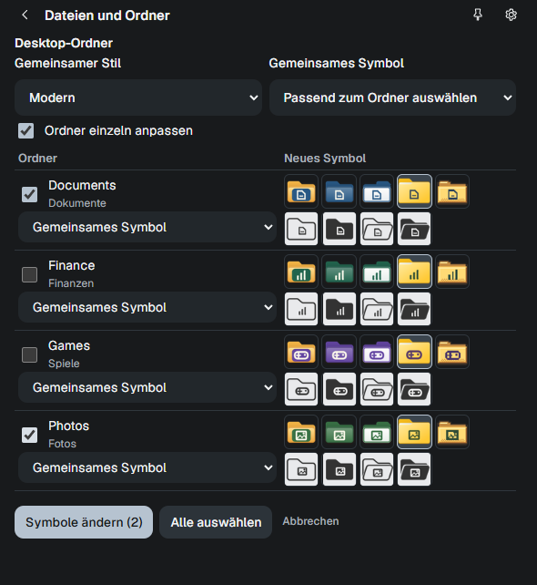
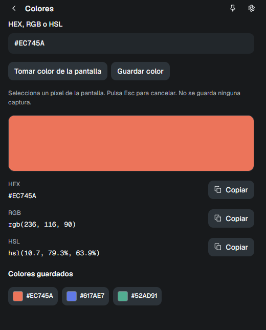

# SideWidget

[Русский](../../README.md) · [English](README.en.md) · [简体中文](README.zh-CN.md) · [日本語](README.ja.md) · **Deutsch** · [Українська](README.uk.md) · [Беларуская](README.be.md) · [Español](README.es.md) · [Português (Brasil)](README.pt-BR.md)

SideWidget ist ein kompaktes Panel mit Werkzeugen für den Windows-Alltag. Am oberen Bildschirmrand zeigt es die Uhrzeit. Ein Klick darauf öffnet die Dateisuche, angeheftete Apps und weitere Werkzeuge. Die voreingestellte Tastenkombination ist `Ctrl+Alt+Space` (Strg+Alt+Leertaste).

SideWidget übernimmt die Sprache von Windows. Ist sie nicht verfügbar, startet die App auf Englisch. Unter **Einstellungen → App-Sprache** kannst du die Sprache wechseln.

SideWidget wird mit gesundem Menschenverstand und mithilfe von GPT-6.1 Sol entwickelt.

## Screenshots

  

  

Der Player wurde unter Windows während der Musikwiedergabe aufgenommen. Die Werkzeugansichten zeigen Beispieldaten.

## Beispielbefehle

Öffne **Dateien und Ordner** und wähle eine Aktion.

- **Dateien sortieren.** Wähle **Rechnungen nach Jahr** und ergänze die Regel **Screenshots / Am aktuellen Ort belassen**. Prüfe die Dateien in der **Vorschau** und bestätige das Verschieben.
- **Ordnersymbole.** Öffne die Desktop-Ordner für die gemeinsame Bearbeitung oder wähle einen einzelnen Ordner aus.

## Weitere Werkzeuge

<strong>Rechner</strong>

Berechne Ausdrücke mit Prozenten und Klammern, kopiere Ergebnisse oder rufe Rechnungen aus dem Verlauf ab.

<strong>QR-Codes</strong>

Wandle Text oder einen Link in einen QR-Code um und speichere ihn als SVG, PNG oder JPEG.

<strong>Einheiten umrechnen</strong>

Rechne Entfernungen, Temperaturen und andere Größen um. Häufig genutzte Einheitenpaare lassen sich speichern.

<strong>Farbpipette</strong>

Wähle eine Bildschirmfarbe, kopiere HEX, RGB oder HSL und speichere die Farbe in der Palette.

## Funktionen

- Taschenrechner mit Verlauf, QR-Codes in SVG, PNG und JPEG, Einheitenumrechnung, Farbpipette und Umrechnung zwischen Farbformaten.
- Dateisuche über eine laufende Everything-Instanz und Schnellzugriff auf angeheftete Apps.
- **Dateien und Ordner.** Dateien auf dem Desktop organisieren, Ordnersymbole in der Vorschau ansehen, einen einheitlichen Stil oder für jeden Ordner einen eigenen wählen und die letzte Symboländerung rückgängig machen.
- Wiedergabesteuerung für kompatible Player, Lautstärkemixer und Systemkennzahlen.
- Kalender, lokaler Markdown-Entwurf und Übersetzung über externe Dienste.
- Einstellbare Größe und Tastenkombination sowie Auswahl der Bildschirme, auf denen das Panel erscheint.

## Installation

Für Windows 10 oder 11 x64. Öffne [Releases](https://github.com/Kelltomal/SideWidget/releases/latest) und wähle eine ZIP-Datei.

- **Lite** (`-lite-win-x64.zip`) ist die empfohlene Version. Fehlende Laufzeitbibliotheken werden separat geladen.
- **Vollversion** (`-portable-win-x64.zip`) enthält die Laufzeitbibliotheken und lässt sich offline starten.

Entpacke die ZIP-Datei in einen eigenen Ordner und starte `SideWidget.exe` neben dem Ordner `App`. Neuere Lite-Versionen laden fehlende Pakete von GitHub in den Ordner `Dependencies`.

### Lite-Abhängigkeiten manuell installieren

Installiere diese x64-Pakete einmal. Die Links führen zu Microsoft-Installern.

- [.NET Runtime 10.0 x64](https://aka.ms/dotnet/10.0/dotnet-runtime-win-x64.exe)
- [ASP.NET Core Runtime 10.0 x64](https://aka.ms/dotnet/10.0/aspnetcore-runtime-win-x64.exe)
- [Windows App Runtime 1.8.12 x64](https://aka.ms/windowsappsdk/1.8/1.8.260921001/windowsappruntimeinstall-x64.exe)
- [Microsoft Edge WebView2 Evergreen](https://go.microsoft.com/fwlink/p/?LinkId=2124703)
- [Microsoft Visual C++ Redistributable v14 x64](https://aka.ms/vc14/vc_redist.x64.exe)

SideWidget sucht beim Start auf GitHub nach stabilen Versionen. Unter **Einstellungen → Updates** ist die Suche ebenfalls verfügbar. Lite verwendet für Updates die Lite-ZIP. Zum Wechsel von Vollversion zu Lite beende SideWidget über das Tray und starte `SideWidget.exe` aus dem Lite-Ordner. Sind alle gemeinsam genutzten Laufzeitbibliotheken bereits installiert, verwendet auch die Vollversion das Lite-Update.

[Everything](../../README.md#everything) · [voidtools x64](https://www.voidtools.com/downloads/)

## Projektdokumentation

[Erstellen und mitwirken](../../CONTRIBUTING.md) · [Technische Dokumentation auf Russisch](technical.ru.md) · [Fehler melden](https://github.com/Kelltomal/SideWidget/issues/new/choose) · [Sicherheitslücke melden](../../SECURITY.md) · [Mit Weblate übersetzen](translating.md)
