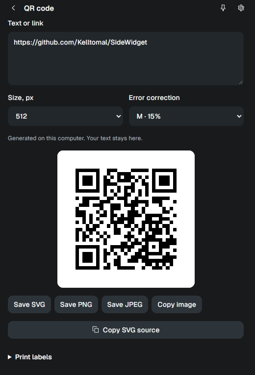

# SideWidget

[Русский](../../README.md) · [English](README.en.md) · [简体中文](README.zh-CN.md) · [日本語](README.ja.md) · **Deutsch** · [Українська](README.uk.md) · [Беларуская](README.be.md) · [Español](README.es.md) · [Português (Brasil)](README.pt-BR.md)

SideWidget ist ein kompaktes Panel mit Werkzeugen für den Windows-Alltag. Am oberen Bildschirmrand zeigt es die Uhrzeit. Ein Klick darauf öffnet die Dateisuche, angeheftete Apps und weitere Werkzeuge. Die voreingestellte Tastenkombination ist `Ctrl+Alt+Space` (Strg+Alt+Leertaste).

SideWidget übernimmt die Sprache von Windows. Ist sie nicht verfügbar, startet die App auf Englisch. Unter **Einstellungen → App-Sprache** kannst du die Sprache wechseln.

SideWidget wird mit gesundem Menschenverstand und mithilfe von GPT-6.1 Sol entwickelt.

## Screenshots

  

  

Der Player wurde unter Windows während der Musikwiedergabe aufgenommen. Die Werkzeugansichten zeigen Beispieldaten.

## Beispielbefehle

Öffne **Dateien und Ordner**, füge einen Befehl ein und prüfe den Vorschauplan vor dem Anwenden.

- **Sortieren.** `Sortiere Rechnungen nach Jahren und lass Screenshots auf dem Desktop`
- **Ordnersymbole.** `Ändere die Ordnersymbole auf dem Desktop` `Ändere das Ordnersymbol zu Fotos`

[Alle neun Sprachen](../../README.md#примеры-команд)

## Weitere Werkzeuge

<strong>Rechner</strong>

Berechne Ausdrücke mit Prozenten und Klammern, kopiere Ergebnisse oder rufe Rechnungen aus dem Verlauf ab.

<strong>QR-Codes</strong>

Wandle Text oder einen Link in einen QR-Code um und speichere ihn als SVG, PNG oder JPEG.

<strong>Einheiten umrechnen</strong>

Rechne Entfernungen, Temperaturen und andere Größen um. Häufig genutzte Einheitenpaare lassen sich speichern.

<strong>Farbpipette</strong>

Wähle eine Bildschirmfarbe, kopiere HEX, RGB oder HSL und speichere die Farbe in der Palette.

## Funktionen

- Taschenrechner mit Verlauf, QR-Codes in SVG, PNG und JPEG, Einheitenumrechnung, Farbpipette und Umrechnung zwischen Farbformaten.
- Dateisuche über eine laufende Everything-Instanz und Schnellzugriff auf angeheftete Apps.
- **Dateien und Ordner.** Dateien auf dem Desktop organisieren, Ordnersymbole in der Vorschau ansehen, einen einheitlichen Stil oder für jeden Ordner einen eigenen wählen und die letzte Symboländerung rückgängig machen.
- Wiedergabesteuerung für kompatible Player, Lautstärkemixer und Systemkennzahlen.
- Kalender mit optionaler SellyBoard-Anbindung, lokaler Markdown-Entwurf und Übersetzung über externe Dienste.
- Einstellbare Größe und Tastenkombination sowie Auswahl der Bildschirme, auf denen das Panel erscheint.

## Erste Schritte

SideWidget benötigt eine kompatible x64-Version von Windows 10 oder 11.

1. Öffne [Releases](https://github.com/Kelltomal/SideWidget/releases/latest) und lade die portable ZIP-Datei für Windows x64 herunter.
2. Entpacke das gesamte Archiv in einen lokalen Ordner mit Schreibzugriff.
3. Starte `SideWidget.App.exe`. Die ZIP-Datei enthält .NET und WebView2. Kopiere beim Wechsel auf einen anderen PC den gesamten entpackten Ordner.

Beim Start sucht SideWidget auf GitHub nach einer stabilen Version. Du kannst sofort aktualisieren, bis zum nächsten Start warten oder diese Version überspringen. Beim Update überprüft SideWidget die SHA-256-Prüfsumme, entpackt das Archiv und startet neu. Unter **Einstellungen → Updates** kannst du die Suche manuell starten.

## Projektdokumentation

[Erstellen und mitwirken](../../CONTRIBUTING.md) · [Technische Dokumentation auf Russisch](technical.ru.md) · [Fehler melden](https://github.com/Kelltomal/SideWidget/issues/new/choose) · [Sicherheitslücke melden](../../SECURITY.md) · [Mit Weblate übersetzen](translating.md)
