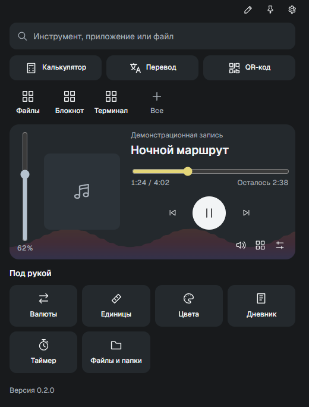
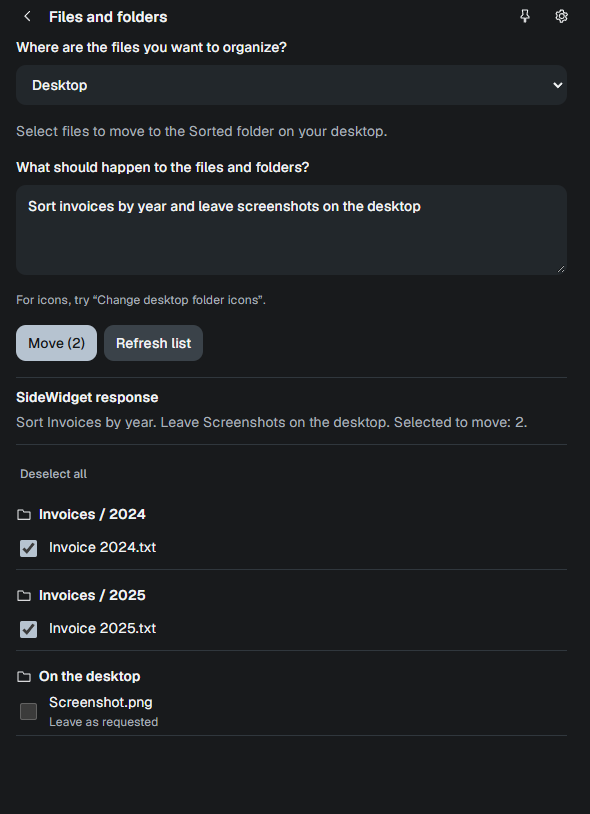

# SideWidget

[Русский](../../README.md) · **English** · [简体中文](README.zh-CN.md) · [日本語](README.ja.md) · [Deutsch](README.de.md) · [Українська](README.uk.md) · [Беларуская](README.be.md) · [Español](README.es.md) · [Português (Brasil)](README.pt-BR.md)

SideWidget is a compact panel for everyday Windows tools. A clock sits at the top edge of the screen. Click it to open file search, pinned apps, and other tools. The default shortcut is `Ctrl+Alt+Space`.

SideWidget follows the Windows display language and falls back to English. You can switch languages under **Settings → App language**.

SideWidget is developed with common sense and help from GPT-6.1 Sol.

## Screenshots

  

  

The player was captured on Windows during music playback. Tool screenshots use sample data.

## Example commands

Open **Files and folders**, paste a command, and review the plan before applying it.

- **Sorting.** `Sort invoices by year and leave screenshots on the desktop`
- **Folder icons.** `Change desktop folder icons` `Change the folder icon to photos`

[All nine languages](../../README.md#примеры-команд)

## More tools

<strong>Calculator</strong>

Evaluate an expression with percentages and parentheses, copy the result, or recall a calculation from history.

<strong>QR codes</strong>

Turn text or a link into a QR code and save it as SVG, PNG, or JPEG.

<strong>Unit converter</strong>

Convert distance, temperature, and other measurements. Save frequently used unit pairs.

<strong>Color picker</strong>

Pick a color from the screen, copy it as HEX, RGB, or HSL, and save it to your palette.

## Features

- Calculator history, QR codes in SVG, PNG, and JPEG, unit conversion, a screen color picker, and color conversion.
- File search through a running Everything instance and quick access to pinned apps.
- **Files and folders.** Organize desktop files, preview folder icons, choose a shared style or set one for each folder, and undo the last icon change.
- Playback controls for compatible players, a volume mixer, and system metrics.
- Calendar, a local Markdown draft, and translation through external services.
- Customizable size, keyboard shortcut, and display selection.

## Getting started

For 64-bit (x64) Windows 10 or 11. Open [Releases](https://github.com/Kelltomal/SideWidget/releases/latest) and choose a ZIP.

- **Lite** (`-lite-win-x64.zip`) uses shared runtimes that you install once.
- **Full** (`-portable-win-x64.zip`) includes its own runtimes for offline use.

Extract the ZIP to its own folder. For Lite, run [Install-Dependencies.bat](../../scripts/Install-Dependencies.bat) from the extracted folder. The script uses WinGet. Then run `SideWidget.exe` beside the `App` folder.

### Install Lite dependencies manually

Install these x64 packages once. The links point to Microsoft installers.

- [.NET Runtime 10.0 x64](https://aka.ms/dotnet/10.0/dotnet-runtime-win-x64.exe)
- [ASP.NET Core Runtime 10.0 x64](https://aka.ms/dotnet/10.0/aspnetcore-runtime-win-x64.exe)
- [Windows App Runtime 1.8.12 x64](https://aka.ms/windowsappsdk/1.8/1.8.260921001/windowsappruntimeinstall-x64.exe)
- [Microsoft Edge WebView2 Evergreen](https://go.microsoft.com/fwlink/p/?LinkId=2124703)
- [Microsoft Visual C++ Redistributable v14 x64](https://aka.ms/vc14/vc_redist.x64.exe)

SideWidget checks stable GitHub releases on startup. You can also check under **Settings → Updates**. Lite updates use the Lite ZIP. To switch from Full to Lite, exit SideWidget from the tray and launch `SideWidget.exe` from the Lite folder. The full edition also selects Lite for updates when the shared runtimes are already installed.

[Everything](../../README.md#everything) · [voidtools x64](https://www.voidtools.com/downloads/)

## Project documentation

[Build and contribute](../../CONTRIBUTING.md) · [Technical reference in Russian](technical.ru.md) · [Report a bug](https://github.com/Kelltomal/SideWidget/issues/new/choose) · [Report a vulnerability](../../SECURITY.md) · [Translate with Weblate](translating.md)
