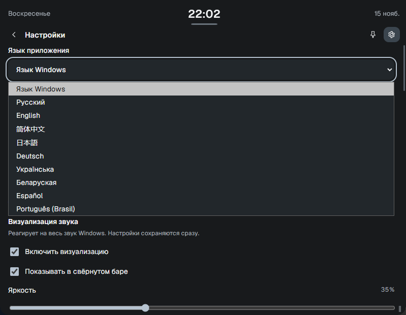

# SideWidget

[Русский](../../README.md) · [English](README.en.md) · [简体中文](README.zh-CN.md) · [日本語](README.ja.md) · [Deutsch](README.de.md) · [Українська](README.uk.md) · [Беларуская](README.be.md) · **Español** · [Português (Brasil)](README.pt-BR.md)

SideWidget es un panel compacto con herramientas para el día a día en Windows. Muestra un reloj en el borde superior de la pantalla. Al hacer clic en él se abre el panel con la búsqueda de archivos, las aplicaciones ancladas y otras herramientas. El atajo predeterminado es `Ctrl+Alt+Space` (Ctrl+Alt+Espacio).

SideWidget usa el idioma de Windows y, si ese idioma no está disponible, se abre en inglés. Puedes cambiarlo en **Configuración → Idioma de la aplicación**.

## Capturas de pantalla

  

  

Las capturas se hicieron en SideWidget para Windows. El panel principal muestra la canción que se estaba reproduciendo.

## Funciones

- Calculadora con historial, códigos QR en SVG, PNG y JPEG, conversión de unidades, cuentagotas de pantalla y conversión entre formatos de color.
- Búsqueda de archivos a través de Everything cuando está en ejecución y acceso rápido a las aplicaciones ancladas.
- **Archivos y carpetas.** Organiza los archivos del escritorio, previsualiza los iconos de las carpetas, elige un estilo común o uno por carpeta y deshaz el último cambio de iconos.
- Controles de reproducción para reproductores compatibles, mezclador de volumen y métricas del sistema.
- Calendario con integración opcional con SellyBoard, borrador local en Markdown y traducción mediante servicios externos.
- Ajuste del tamaño y del atajo de teclado, y selección de las pantallas en las que aparece el panel.

## Primeros pasos

SideWidget requiere una versión compatible de Windows 10 u 11 para x64.

1. Abre [Releases](https://github.com/Kelltomal/SideWidget/releases/latest) y descarga el ZIP portátil para Windows x64.
2. Extrae el archivo completo en una carpeta local con permisos de escritura.
3. Ejecuta `SideWidget.App.exe`. El ZIP incluye .NET y WebView2. Para trasladar la aplicación a otro equipo, copia toda la carpeta extraída.

Al iniciarse, SideWidget busca una versión estable más reciente en GitHub. Puedes actualizar ahora, aplazarlo hasta el próximo inicio u omitir esa versión. Al actualizar, SideWidget verifica el SHA-256 del ZIP, extrae los archivos y se reinicia. Puedes buscar actualizaciones en **Configuración → Actualizaciones**.

## Documentación del proyecto

[Compilar y contribuir](../../CONTRIBUTING.md) · [Referencia técnica en ruso](technical.ru.md) · [Informar de un fallo](https://github.com/Kelltomal/SideWidget/issues/new/choose) · [Informar de una vulnerabilidad](../../SECURITY.md)
