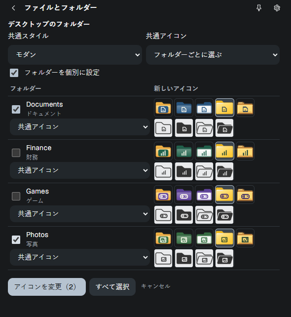

# SideWidget

[Русский](../../README.md) · [English](README.en.md) · [简体中文](README.zh-CN.md) · **日本語** · [Deutsch](README.de.md) · [Українська](README.uk.md) · [Беларуская](README.be.md) · [Español](README.es.md) · [Português (Brasil)](README.pt-BR.md)

SideWidget は、日常的に使うツールをまとめた Windows 向けのコンパクトなパネルです。画面上端の時計をクリックすると、ファイル検索やピン留めしたアプリなどにアクセスできます。既定のショートカットは `Ctrl+Alt+Space` です。

SideWidget は Windows の表示言語に合わせます。対応していない言語の場合は英語で起動します。**設定 → アプリの言語**で変更できます。

SideWidget は常識を大切にし、GPT-6.1 Sol の支援を受けて開発しています。

## スクリーンショット

  

  

プレーヤーは Windows で音楽を再生中に撮影しました。各ツールの画面にはサンプルデータを使用しています。

## 指示の例

**ファイルとフォルダー**を開き、指示を貼り付けて、適用する前にプレビューを確認します。

- **ファイル整理.** `請求書を年別に整理して、スクリーンショットはデスクトップに残して`
- **フォルダーアイコン.** `デスクトップのフォルダーアイコンを変更して` `フォルダーアイコンを写真に変更して`

[9 言語すべての例](../../README.md#примеры-команд)

## その他のツール

<strong>電卓</strong>

パーセントや括弧を含む式を計算し、結果をコピーしたり履歴を参照したりできます。

<strong>QR コード</strong>

テキストやリンクを QR コードにして SVG、PNG、JPEG で保存できます。

<strong>単位変換</strong>

距離や温度などを変換します。よく使う単位の組み合わせはお気に入りに登録できます。

<strong>カラーピッカー</strong>

画面から色を拾い、HEX、RGB、HSL でコピーしたりパレットに保存したりできます。

## 主な機能

- 履歴付きの電卓、SVG・PNG・JPEG 形式の QR コード、単位換算、画面からの色の取得、色形式の変換。
- 起動中の Everything を使ったファイル検索と、ピン留めしたアプリの起動。
- **ファイルとフォルダー。** デスクトップのファイル整理、フォルダーアイコンのプレビュー、共通スタイルまたはフォルダーごとのスタイル設定、直前のアイコン変更の取り消し。
- 対応プレーヤーの再生操作、音量ミキサー、PC のシステム情報の表示。
- SellyBoard と連携できるカレンダー、ローカルに保存する Markdown の下書き、外部サービスを利用した翻訳。
- パネルのサイズやショートカットの変更、表示するモニターの選択。

## 使い始める

対応する Windows 10 または 11（x64）が必要です。

1. [Releases](https://github.com/Kelltomal/SideWidget/releases/latest) を開き、Windows x64 向けのポータブル版 ZIP をダウンロードします。
2. ZIP 全体を書き込み可能なローカルフォルダーに展開します。
3. `SideWidget.App.exe` を起動します。ZIP には .NET と WebView2 が含まれます。別の PC に移す場合は、展開したフォルダーごとコピーしてください。

起動時に GitHub で新しい安定版を確認します。今すぐ更新、次回起動時に再通知、このバージョンをスキップ、のいずれかを選べます。更新時は ZIP の SHA-256 を確認して展開し、SideWidget が再起動します。**設定 → 更新**からも手動で確認できます。

## プロジェクトのドキュメント

[ビルドとコントリビュート](../../CONTRIBUTING.md) · [技術資料（ロシア語）](technical.ru.md) · [不具合を報告](https://github.com/Kelltomal/SideWidget/issues/new/choose) · [脆弱性を報告](../../SECURITY.md) · [Weblate で翻訳](translating.md)
