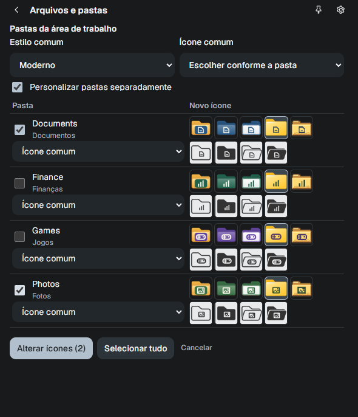
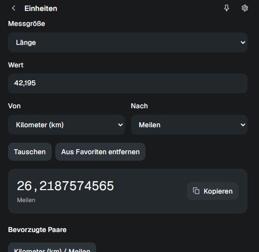

# SideWidget

[Русский](../../README.md) · [English](README.en.md) · [简体中文](README.zh-CN.md) · [日本語](README.ja.md) · [Deutsch](README.de.md) · [Українська](README.uk.md) · [Беларуская](README.be.md) · [Español](README.es.md) · **Português (Brasil)**

SideWidget é um painel compacto com ferramentas para o dia a dia no Windows. Um relógio fica visível no topo da tela. Clique nele para abrir a busca de arquivos, os aplicativos fixados e outras ferramentas. O atalho padrão é `Ctrl+Alt+Space` (Ctrl+Alt+Espaço).

O SideWidget segue o idioma de exibição do Windows. Se o idioma não estiver disponível, o aplicativo abre em inglês. Altere o idioma em **Configurações → Idioma do aplicativo**.

O SideWidget é desenvolvido com bom senso e com a ajuda do GPT-6.1 Sol.

## Capturas de tela

  

  

O player foi capturado no Windows durante a reprodução de música. As ferramentas usam dados de exemplo nas capturas.

## Exemplos de comandos

Abra **Arquivos e pastas** e escolha uma ação.

- **Organizar arquivos.** Escolha **Faturas por ano** e adicione uma regra para deixar as capturas de tela no lugar. Confira a lista na prévia e confirme a movimentação.
- **Ícones de pastas.** Abra as pastas da área de trabalho para editar várias ou escolha uma pasta específica.

## Mais ferramentas

<strong>Calculadora</strong>

Calcule expressões com porcentagens e parênteses, copie o resultado ou consulte o histórico.

<strong>Códigos QR</strong>

Transforme texto ou links em códigos QR e salve em SVG, PNG ou JPEG.

<strong>Conversor de unidades</strong>

Converta distâncias, temperaturas e outras medidas. Salve os pares de unidades usados com frequência.

<strong>Conta-gotas</strong>

Capture uma cor da tela, copie em HEX, RGB ou HSL e salve na paleta.

## Recursos

- Calculadora com histórico, códigos QR em SVG, PNG e JPEG, conversão de unidades, conta-gotas e conversão entre formatos de cor.
- Busca de arquivos com o Everything em execução e acesso rápido aos aplicativos fixados.
- **Arquivos e pastas.** Organize os arquivos da área de trabalho, visualize os ícones das pastas antes de aplicar mudanças, use um estilo único ou defina um para cada pasta e desfaça a última alteração nos ícones.
- Controles de reprodução para players compatíveis, mixer de volume e métricas do sistema.
- Calendário, rascunho local em Markdown e tradução por serviços externos.
- Ajuste do tamanho do painel e do atalho, além da escolha dos monitores em que ele aparece.

## Instalação

Para Windows 10 ou 11 x64. Abra [Releases](https://github.com/Kelltomal/SideWidget/releases/latest) e escolha um ZIP.

- **Lite** (`-lite-win-x64.zip`) é a versão recomendada. As dependências que faltam são baixadas separadamente.
- **Completa** (`-portable-win-x64.zip`) inclui as dependências para execução offline.

Extraia o ZIP em uma pasta própria e abra `SideWidget.exe` ao lado da pasta `App`. As novas versões Lite baixam do GitHub os pacotes que faltam e os instalam na pasta `Dependencies`.

### Instalar manualmente as dependências do Lite

Instale estes pacotes x64 uma vez. Os links levam aos instaladores da Microsoft.

- [.NET Runtime 10.0 x64](https://aka.ms/dotnet/10.0/dotnet-runtime-win-x64.exe)
- [ASP.NET Core Runtime 10.0 x64](https://aka.ms/dotnet/10.0/aspnetcore-runtime-win-x64.exe)
- [Windows App Runtime 1.8.12 x64](https://aka.ms/windowsappsdk/1.8/1.8.260921001/windowsappruntimeinstall-x64.exe)
- [Microsoft Edge WebView2 Evergreen](https://go.microsoft.com/fwlink/p/?LinkId=2124703)
- [Microsoft Visual C++ Redistributable v14 x64](https://aka.ms/vc14/vc_redist.x64.exe)

O SideWidget verifica versões estáveis no GitHub ao iniciar. Também é possível usar **Configurações → Atualizações**. As atualizações do Lite usam o ZIP Lite. Para trocar da versão completa para Lite, saia pelo ícone da bandeja e execute `SideWidget.exe` na pasta do Lite. A versão completa também escolhe a atualização Lite quando todas as dependências compartilhadas já estão instaladas.

[Everything](../../README.md#everything) · [voidtools x64](https://www.voidtools.com/downloads/)

## Documentação do projeto

[Compilar e contribuir](../../CONTRIBUTING.md) · [Referência técnica em russo](technical.ru.md) · [Relatar um erro](https://github.com/Kelltomal/SideWidget/issues/new/choose) · [Relatar uma vulnerabilidade](../../SECURITY.md) · [Traduza com o Weblate](translating.md)
