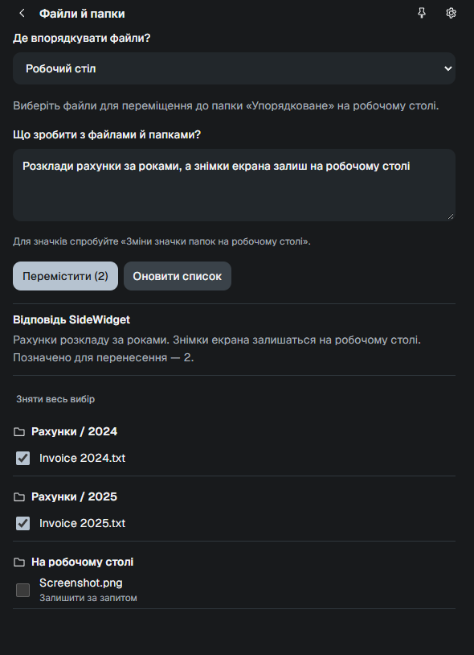
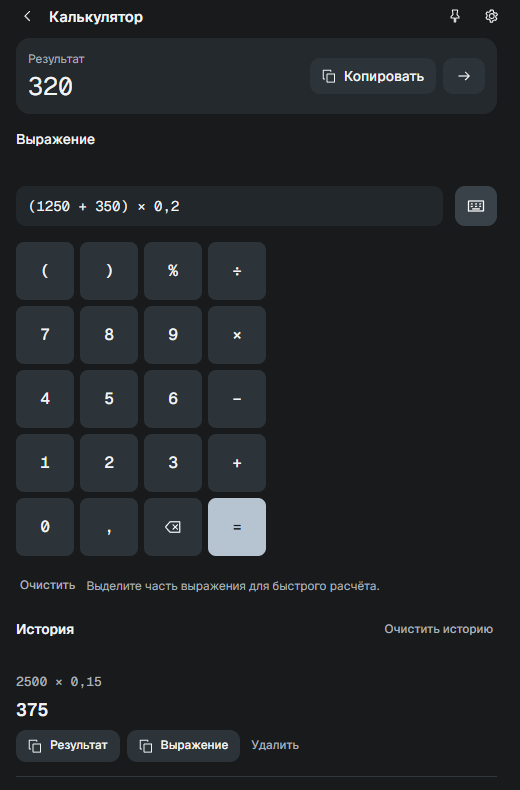

# SideWidget

[Русский](../../README.md) · [English](README.en.md) · [简体中文](README.zh-CN.md) · [日本語](README.ja.md) · [Deutsch](README.de.md) · **Українська** · [Беларуская](README.be.md) · [Español](README.es.md) · [Português (Brasil)](README.pt-BR.md)

SideWidget — компактна панель для повсякденних завдань у Windows. Біля верхнього краю екрана видно годинник. Натисніть на нього, щоб відкрити пошук файлів, закріплені програми та інші інструменти. Типове сполучення клавіш — `Ctrl+Alt+Space`.

SideWidget використовує мову Windows. Якщо її немає в списку, застосунок відкривається англійською. Мову можна змінити в меню **Налаштування → Мова застосунку**.

SideWidget розробляється зі здоровим глуздом і за допомогою GPT-6.1 Sol.

## Знімки екрана

  

  

Програвач знято у Windows під час відтворення музики. На знімках інструментів використано демонстраційні дані.

## Приклади команд

Відкрийте **Файли й папки**, вставте команду й перевірте план перед застосуванням.

- **Сортування.** `Розклади рахунки за роками, а знімки екрана залиш на робочому столі`
- **Значки папок.** `Зміни значки папок на робочому столі` `Зміни значок папки на фото`

[Усі дев’ять мов](../../README.md#примеры-команд)

## Інші інструменти

<strong>Калькулятор</strong>

Обчислюйте вирази з відсотками й дужками, копіюйте результат і повертайтеся до обчислень з історії.

<strong>QR-коди</strong>

Перетворюйте текст або посилання на QR-код і зберігайте його у SVG, PNG чи JPEG.

<strong>Конвертер одиниць</strong>

Перетворюйте відстані, температуру й інші величини. Улюблені пари одиниць можна зберегти.

<strong>Піпетка й кольори</strong>

Виберіть колір з екрана, скопіюйте його у HEX, RGB чи HSL та збережіть у палітрі.

## Можливості

- Калькулятор з історією, QR-коди у форматах SVG, PNG і JPEG, перетворення одиниць, піпетка та перетворення форматів кольорів.
- Пошук файлів через запущений Everything і швидкий запуск закріплених програм.
- **Файли й папки.** Упорядкування файлів на робочому столі, попередній перегляд значків папок, спільний стиль або окремий для кожної папки та скасування останньої зміни значків.
- Керування відтворенням у сумісних програвачах, мікшер гучності й показники системи.
- Календар із можливістю підключення SellyBoard, локальна чернетка Markdown і переклад через зовнішні сервіси.
- Налаштування розміру, сполучення клавіш і вибір моніторів, на яких відображається панель.

## Перший запуск

Потрібна сумісна версія Windows 10 або 11 для x64.

1. Відкрийте [Releases](https://github.com/Kelltomal/SideWidget/releases/latest) і завантажте портативний ZIP для Windows x64.
2. Розпакуйте весь архів до локальної папки з доступом на запис.
3. Запустіть `SideWidget.App.exe`. Архів містить .NET і WebView2. Щоб перенести застосунок на інший комп’ютер, скопіюйте всю розпаковану папку.

Під час запуску SideWidget шукає новіший стабільний випуск на GitHub. Можна оновити одразу, відкласти до наступного запуску або пропустити цю версію. Під час оновлення SideWidget перевіряє SHA-256 архіву, розпаковує збірку й перезапускається. Запустити перевірку вручну можна в меню **Налаштування → Оновлення**.

## Документація проєкту

[Збирання та участь у розробці](../../CONTRIBUTING.md) · [Технічна довідка російською](technical.ru.md) · [Повідомити про помилку](https://github.com/Kelltomal/SideWidget/issues/new/choose) · [Повідомити про вразливість](../../SECURITY.md) · [Переклад через Weblate](translating.md)
