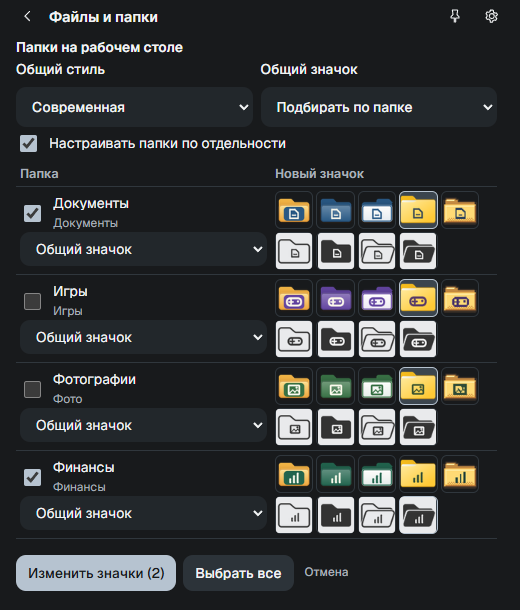

# SideWidget

[Русский](../../README.md) · [English](README.en.md) · [简体中文](README.zh-CN.md) · [日本語](README.ja.md) · [Deutsch](README.de.md) · **Українська** · [Беларуская](README.be.md) · [Español](README.es.md) · [Português (Brasil)](README.pt-BR.md)

SideWidget — компактна панель для повсякденних завдань у Windows. Біля верхнього краю екрана видно годинник. Натисніть на нього, щоб відкрити пошук файлів, закріплені програми та інші інструменти. Типове сполучення клавіш — `Ctrl+Alt+Space`.

Вище наведено мови документації. Інтерфейс застосунку російською.

## Знімки екрана

  
  

На знімках використано демонстраційні дані.

## Можливості

- Калькулятор з історією, QR-коди у форматах SVG, PNG і JPEG, перетворення одиниць, піпетка та перетворення форматів кольорів.
- Пошук файлів через запущений Everything і швидкий запуск закріплених програм.
- **Файли й папки.** Упорядкування файлів на робочому столі, попередній перегляд значків папок, спільний стиль або окремий для кожної папки та скасування останньої зміни значків.
- Керування відтворенням у сумісних програвачах, мікшер гучності й показники системи.
- Календар із можливістю підключення SellyBoard, локальна чернетка Markdown і переклад через зовнішні сервіси.
- Налаштування розміру, сполучення клавіш і вибір моніторів, на яких відображається панель.

## Перший запуск

Потрібна сумісна версія Windows 10 або 11 для x64.

1. Відкрийте [Releases](https://github.com/Kelltomal/SideWidget/releases) і завантажте портативний ZIP для Windows x64, щойно він стане доступним.
2. Розпакуйте весь архів до локальної папки з доступом на запис.
3. Запустіть `SideWidget.App.exe`. Архів містить .NET і WebView2. Щоб перенести застосунок на інший комп’ютер, скопіюйте всю розпаковану папку.

У **Налаштуваннях** можна перевірити, чи є на GitHub новіший стабільний випуск, і відкрити його сторінку в браузері. Нову версію потрібно завантажити вручну.

## Документація проєкту

[Збирання та участь у розробці](../../CONTRIBUTING.md) · [Технічна довідка російською](technical.ru.md) · [Повідомити про помилку](https://github.com/Kelltomal/SideWidget/issues/new/choose) · [Повідомити про вразливість](../../SECURITY.md)
