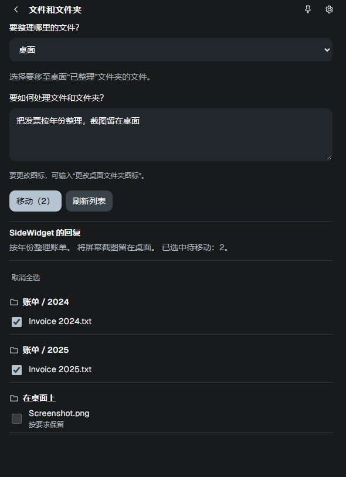

# SideWidget

[Русский](../../README.md) · [English](README.en.md) · **简体中文** · [日本語](README.ja.md) · [Deutsch](README.de.md) · [Українська](README.uk.md) · [Беларуская](README.be.md) · [Español](README.es.md) · [Português (Brasil)](README.pt-BR.md)

SideWidget 是一款适用于 Windows 的小巧工具面板。屏幕顶部显示时钟，点击时钟即可打开面板，搜索文件、启动常用应用或使用其他工具。默认快捷键为 `Ctrl+Alt+Space`。

SideWidget 默认使用 Windows 显示语言。如果不支持该语言，则使用英语。可在**设置 → 应用语言**中切换语言。

SideWidget 的开发以常识为基础，并借助 GPT-6.1 Sol。

## 界面截图

  

  

播放器截图拍摄于 Windows 正在播放音乐时。各工具的截图使用演示数据。

## 指令示例

打开**文件和文件夹**，粘贴指令并检查预览，再应用更改。

- **整理文件.** `把发票按年份整理，截图留在桌面`
- **文件夹图标.** `更改桌面文件夹图标` `将文件夹图标改为照片`

[全部九种语言](../../README.md#примеры-команд)

## 更多工具

<strong>计算器</strong>

计算带百分比和括号的表达式，复制结果或查看计算历史。

<strong>二维码</strong>

将文本或链接生成二维码，并保存为 SVG、PNG 或 JPEG。

<strong>单位换算</strong>

换算距离、温度等数值，并收藏常用的单位组合。

<strong>取色器</strong>

从屏幕取色，复制 HEX、RGB 或 HSL 数值，并将颜色收藏到调色板。

## 功能

- 带历史记录的计算器、支持 SVG、PNG 和 JPEG 的二维码、单位换算、屏幕取色和颜色格式转换。
- 通过已安装并运行的 Everything 搜索文件，快速启动固定的应用。
- **文件和文件夹。** 整理桌面文件、预览文件夹图标、统一设置图标样式或逐个设置，并撤销上一次图标修改。
- 控制兼容的播放器、调整各应用音量、查看系统指标。
- 日历支持接入 SellyBoard，另有本地 Markdown 草稿和由外部服务提供的翻译功能。
- 可调整面板尺寸和快捷键，也可选择在哪些显示器上显示。

## 开始使用

需要兼容的 Windows 10 或 11（x64）。

1. 打开 [Releases](https://github.com/Kelltomal/SideWidget/releases/latest) 页面，下载 Windows x64 便携版 ZIP。
2. 将整个压缩包解压到本地可写入的文件夹。
3. 运行 `SideWidget.App.exe`。压缩包已包含 .NET 和 WebView2。将应用迁移到其他电脑时，请保留完整的解压文件夹。

启动时，SideWidget 会在 GitHub 上检查是否有更新的稳定版。你可以立即更新、下次启动时提醒或跳过此版本。更新时，SideWidget 会验证 ZIP 的 SHA-256 校验值、解压文件并重新启动。也可在**设置 → 更新**中手动检查。

## 项目文档

[构建与贡献指南](../../CONTRIBUTING.md) · [技术参考（俄语）](technical.ru.md) · [报告问题](https://github.com/Kelltomal/SideWidget/issues/new/choose) · [报告安全漏洞](../../SECURITY.md) · [通过 Weblate 翻译](translating.md)
